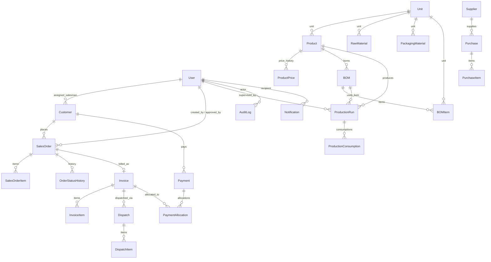

# SmartFactory – Database Schema (PostgreSQL)

All tables use PostgreSQL relational constraints, foreign keys, `NUMERIC` (`Decimal`) types for monetary and quantity fields, and audit timestamps (`created_at`, `updated_at`).

---

## 1. Entity Relationship Overview

---

## 2. Tables & Key Columns

### Accounts & System (`apps/accounts`)
1. **`accounts_user`** (Custom `AbstractUser`)
   - `id`, `username` (unique), `email` (unique), `password` (PBKDF2 hashed), `first_name`, `last_name`, `phone`
   - `role`: enum (`SALESMAN`, `ADMIN`, `PRODUCTION`, `ACCOUNTANT`, `OWNER`)
   - `is_active`, `created_at`, `updated_at`
2. **`accounts_companysetting`** (Singleton factory configuration)
   - `company_name`, `gstin`, `state` (default: `Tamil Nadu`), `address`, `phone`, `email`, `invoice_prefix` (`SF`), `variance_tolerance_pct` (`3.00`), `financial_year` (`2025-26`)
3. **`accounts_auditlog`**
   - `id`, `user_id` (FK), `action`, `entity_type`, `entity_id`, `summary`, `metadata` (JSONB), `ip_address`, `created_at`
4. **`accounts_notification`**
   - `id`, `recipient_id` (FK, nullable for role broadcast), `target_role`, `title`, `message`, `event_type`, `entity_type`, `entity_id`, `is_read`, `created_at`

### Masters & BOM (`apps/masters`)
5. **`masters_unit`**
   - `id`, `name`, `symbol` (`kg`, `L`, `pkt`, `pcs`)
6. **`masters_customer`**
   - `id`, `code` (unique), `name`, `customer_type` (`RETAILER`, `DISTRIBUTOR`, `WHOLESALER`, `SUPERMARKET`), `state`, `gstin`, `contact_person`, `phone`, `email`, `address`, `credit_limit`, `assigned_salesman_id` (FK `User`, nullable), `is_active`, `created_at`, `updated_at`
7. **`masters_supplier`**
   - `id`, `code` (unique), `name`, `gstin`, `state`, `contact_person`, `phone`, `email`, `address`, `is_active`, `created_at`, `updated_at`
8. **`masters_product`**
   - `id`, `sku` (unique), `name`, `category` (`MURUKKU`, `MIXTURE`, `CHIPS`, `SWEETS`), `pack_size`, `unit_id` (FK), `hsn_code` (default `21069099`), `gst_rate` (`5.00`), `selling_price` (`NUMERIC(12,2)`), `reorder_level` (`NUMERIC(12,3)`), `image_url`, `description`, `is_active`
9. **`masters_productprice`**
   - `id`, `product_id` (FK), `price` (`NUMERIC(12,2)`), `effective_from`, `effective_to`, `created_by_id` (FK)
10. **`masters_rawmaterial`**
    - `id`, `code` (unique), `name`, `unit_id` (FK), `reorder_level`, `weighted_avg_cost` (`NUMERIC(12,4)`), `is_active`
11. **`masters_packagingmaterial`**
    - `id`, `code` (unique), `name`, `unit_id` (FK), `reorder_level`, `weighted_avg_cost` (`NUMERIC(12,4)`), `is_active`
12. **`masters_bom`**
    - `id`, `product_id` (FK), `version`, `expected_output_qty` (`NUMERIC(12,3)`), `is_active`, `notes`, `created_by_id`, `created_at`
13. **`masters_bomitem`**
    - `id`, `bom_id` (FK), `material_type` (`RAW`, `PACKAGING`), `raw_material_id` (FK, nullable), `packaging_material_id` (FK, nullable), `standard_qty` (`NUMERIC(12,3)`), `unit_id` (FK)

### Inventory & Stock Ledger (`apps/inventory`)
14. **`inventory_stockledger`** (Append-only single source of truth)
    - `id`, `item_type` (`RAW`, `PACKAGING`, `FINISHED`)
    - `raw_material_id` (FK, nullable), `packaging_material_id` (FK, nullable), `product_id` (FK, nullable)
    - `movement_type` (`OPENING`, `PURCHASE_RECEIPT`, `PRODUCTION_ISSUE`, `PRODUCTION_OUTPUT`, `SALES_DISPATCH`, `RETURN`, `ADJUSTMENT`)
    - `quantity_delta` (`NUMERIC(14,3)` — positive for inward, negative for outward)
    - `unit_cost` (`NUMERIC(12,4)`), `total_value` (`NUMERIC(14,2)`), `running_balance` (`NUMERIC(14,3)`)
    - `source_type`, `source_id`, `reference_no`, `notes`, `created_by_id` (FK), `created_at`

### Purchases (`apps/purchases`)
15. **`purchases_purchase`**
    - `id`, `purchase_number` (unique), `supplier_id` (FK), `purchase_date`, `invoice_ref`, `status` (`DRAFT`, `CONFIRMED`, `CANCELLED`), `total_amount` (`NUMERIC(14,2)`), `notes`, `confirmed_by_id`, `confirmed_at`, `created_by_id`, `created_at`
16. **`purchases_purchaseitem`**
    - `id`, `purchase_id` (FK), `material_type` (`RAW`, `PACKAGING`), `raw_material_id`, `packaging_material_id`, `quantity`, `unit_rate`, `line_total`

### Production & Costing (`apps/production`)
17. **`production_productionrun`**
    - `id`, `run_number` (unique), `product_id` (FK), `bom_id` (FK), `run_date`, `batch_multiplier`, `expected_output_qty`, `actual_good_output_qty`, `wastage_qty`, `damaged_packaging_qty`
    - `yield_variance_pct`, `has_variance_flag`
    - `raw_material_cost`, `packaging_cost`, `labour_cost`, `gas_power_cost`, `other_overhead_cost`, `total_production_cost`, `cost_per_good_packet`
    - `status` (`DRAFT`, `CONFIRMED`), `notes`, `supervised_by_id`, `confirmed_by_id`, `confirmed_at`, `created_at`
18. **`production_productionconsumption`**
    - `id`, `production_run_id` (FK), `material_type`, `raw_material_id`, `packaging_material_id`, `planned_qty`, `actual_qty`, `damaged_qty`, `variance_qty`, `variance_pct`, `is_variance_flagged`, `unit_cost`, `total_cost`
19. **`production_expense`**
    - `id`, `production_run_id` (FK, nullable), `category` (`LABOUR`, `GAS_POWER`, `MAINTENANCE`, `OTHER`), `description`, `amount`, `expense_date`, `recorded_by_id`, `created_at`

### Sales, Invoicing, Dispatch & Payments (`apps/sales`)
20. **`sales_salesorder`**
    - `id`, `order_number` (unique), `idempotency_key` (unique, nullable), `customer_id` (FK), `salesman_id` (FK), `order_date`
    - `status` (`SUBMITTED`, `PENDING_APPROVAL`, `APPROVED`, `INVOICED`, `DISPATCHED`, `REJECTED`)
    - `subtotal`, `tax_estimate`, `grand_total`, `delivery_notes`, `rejection_reason`, `approved_by_id`, `approved_at`, `created_at`, `updated_at`
21. **`sales_salesorderitem`**
    - `id`, `order_id` (FK), `product_id` (FK), `quantity`, `unit_price`, `gst_rate`, `taxable_amount`, `gst_amount`, `line_total`
22. **`sales_orderstatushistory`**
    - `id`, `order_id` (FK), `from_status`, `to_status`, `changed_by_id`, `remarks`, `created_at`
23. **`sales_invoice`**
    - `id`, `invoice_number` (unique), `financial_year`, `invoice_date`, `order_id` (OneToOne FK), `customer_id` (FK)
    - `seller_name`, `seller_gstin`, `seller_state`, `customer_name`, `customer_gstin`, `customer_state`, `customer_address`
    - `is_inter_state`, `taxable_total`, `cgst_total`, `sgst_total`, `igst_total`, `grand_total`, `credit_notes_total`, `created_by_id`, `created_at`
24. **`sales_invoiceitem`**
    - `id`, `invoice_id` (FK), `product_id` (FK), `product_name`, `hsn_code`, `quantity`, `unit_price`, `taxable_amount`, `gst_rate`, `cgst_amount`, `sgst_amount`, `igst_amount`, `line_total`
25. **`sales_dispatch`**
    - `id`, `dispatch_number` (unique), `invoice_id` (FK), `order_id` (FK), `dispatch_date`, `vehicle_no`, `transporter`, `notes`, `dispatched_by_id`, `created_at`
26. **`sales_dispatchitem`**
    - `id`, `dispatch_id` (FK), `invoice_item_id` (FK), `product_id` (FK), `dispatched_qty`
27. **`sales_payment`**
    - `id`, `payment_number` (unique), `idempotency_key` (unique, nullable), `customer_id` (FK), `payment_date`, `amount`, `payment_mode` (`CASH`, `UPI`, `BANK_TRANSFER`, `CHEQUE`), `reference_number`, `notes`, `recorded_by_id`, `created_at`
28. **`sales_paymentallocation`**
    - `id`, `payment_id` (FK), `invoice_id` (FK), `allocated_amount`, `created_at`
