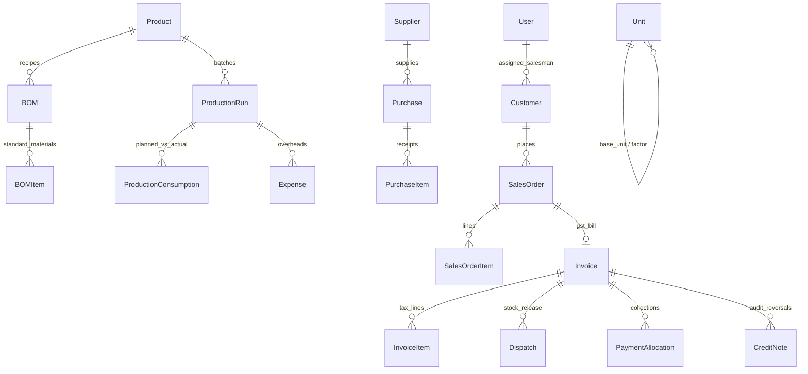

# SmartFactory ERP — Architecture & Design Note

**Assignment:** Order-to-Audit System for a Small Food Manufacturer  
**Institution:** Centre for Digital Infrastructure, NIT Tiruchirappalli  
**Stack:** React 18 + TypeScript + Tailwind CSS (Vite) · Django 5 + DRF + Channels (ASGI) · PostgreSQL 16

---

## 1. System Design & Data Model

SmartFactory links two operational loops at a single, immutable source of truth — **`inventory_stockledger`**:

- **Sales Loop:** Salesman Mobile Order → Admin Verification (Qty/Price Edit + Live Stock Check) → GST Invoice (`CGST+SGST` intra-state or `IGST` inter-state, FY-numbered, ReportLab PDF) → Dispatch (`SALES_DISPATCH` ledger issue) → Payment Allocation & Ageing (or Audit Credit Note).
- **Production Loop:** Supplier Purchase (`PURCHASE_RECEIPT` ledger receipt + Weighted Average update) → Active BOM Recipe (with unit conversions) → Atomic Production Run (`PRODUCTION_ISSUE` raw & packaging deductions including damaged packaging + `PRODUCTION_OUTPUT` good finished packets) → Variance Alerts (>3%) & Product Costing.

---

## 2. Ledger-Driven Inventory & Unit Conversion

### Single Source of Truth (`StockLedger`)
- Stock balances are **never** stored as manually editable numbers. Every balance is aggregated from append-only `StockLedger` rows:
  $$\text{Closing Stock} = \text{Opening} + \text{Receipts} - \text{Issues} + \text{Adjustments}$$
- Every ledger row stores `source_type` (`OPENING`, `PURCHASE`, `PRODUCTION_RUN`, `DISPATCH`, `CREDIT_NOTE`, `ADJUSTMENT`), `source_id`, `reference_no`, `unit_cost`, `running_balance`, `created_by`, and `created_at`.
- **Concurrency Safety:** `record_stock_movement()` executes inside `@transaction.atomic` with `select_for_update()` on the item master row (`RawMaterial`, `PackagingMaterial`, or `Product`), rejecting any issue that would produce negative inventory (verified via multi-threaded PostgreSQL tests).

### BOM & Unit Conversion Engine
- `Unit` supports hierarchical conversions via `(base_unit, factor_to_base)` using `Decimal` arithmetic:
  - `1 kg = 1,000 g` (`g.factor_to_base = 0.001000`)
  - `1 L = 1,000 ml` (`ml.factor_to_base = 0.001000`)
  - `1 carton = 20 packets` (`ctn.factor_to_base = 20.000000`)
- When planning or executing a production run, BOM items and actual consumption inputs entered in any compatible unit (e.g., `1200 g` for Spice Mix stocked in `kg`) are converted to the material's inventory unit before computing variance and posting `PRODUCTION_ISSUE` ledger entries.
- **Damaged Packaging Rule:** Total issued packaging deducted from inventory is `actual_good_used + damaged_qty` (e.g., `188 + 6 = 194` pouches deducted from `500` → `306` closing).

### Variance Formulas (3% Default Tolerance)
- **Consumption Variance %:** $\frac{\text{Total Issued} - \text{Planned}}{\text{Planned}} \times 100$ (e.g., Oil: $\frac{10.5 - 10.0}{10.0} \times 100 = +5.00\%$, flagged)
- **Yield Variance %:** $\frac{\text{Actual Good Output} - \text{Expected Output}}{\text{Expected Output}} \times 100$ (e.g., $\frac{188 - 200}{200} \times 100 = -6.00\%$, flagged)

---

## 3. Costing, Valuation & Tax Integrity

### Material Valuation: Moving Weighted Average Cost
- Selected over Last Price (which distorts cost when rates spike) and FIFO (which requires batch-lot tracking for bulk flour/oil bins).
- On every `OPENING` or `PURCHASE_RECEIPT` movement, `weighted_avg_cost` updates atomically:
  $$\text{New Avg Cost} = \frac{(\text{Existing Qty} \times \text{Old Avg}) + (\text{Receipt Qty} \times \text{Purchase Rate})}{\text{Existing Qty} + \text{Receipt Qty}}$$
- **Benchmark Flour Valuation:** Opening `100 kg @ ₹42` + Purchase `60 kg @ ₹45` = `₹6,900 / 160 kg = ₹43.1250/kg`.

### Overhead Allocation & Cost per Good Packet
- Direct batch overheads (**Labour** + **Gas/Power** + **Other**) are recorded against each `ProductionRun` (and mirrored into `production_expense`) and allocated across **Actual Good Packets** produced, so yield loss naturally increases unit cost:
  $$\text{Cost per Good Packet} = \frac{\text{Actual Raw Cost} + \text{Actual Packaging Cost (incl. damaged)} + \text{Batch Overheads}}{\text{Actual Good Packets}}$$
- **Section 5 Benchmark Breakdown (188 good packets):**
  - Raw Materials: Flour (`40 × ₹43.125 = ₹1,725`) + Oil (`10.5 × ₹140 = ₹1,470`) + Spice (`1.2 × ₹200 = ₹240`) = **₹3,435.00**
  - Packaging: Pouches (`194 × ₹2.50 = ₹485`) + Cartons (`9 × ₹15 = ₹135`) = **₹620.00**
  - Overheads: Labour (`₹1,200`) + Gas/Power (`₹600`) = **₹1,800.00**
  - **Total Cost:** **₹5,855.00** → **Cost / Good Packet = ₹31.1436** → **Gross Margin vs ₹50 selling price = ₹18.86/pkt (37.7%)**.

### Financial Precision & Audit Trail
- All monetary and quantity columns use PostgreSQL `NUMERIC` (`Decimal`, `ROUND_HALF_UP`) — never floating-point arithmetic.
- Posted GST invoices are immutable and cannot be deleted; reversals are executed via **`CreditNote`** (`CN/2025-26/xxxx`) with mandatory audit reason and optional finished-goods return restock.
