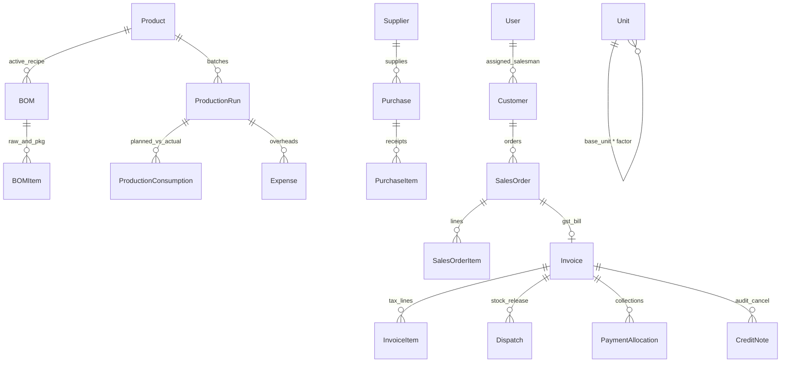

# FactoraX ERP — Design Note (Order-to-Audit System)

**Institution:** Centre for Digital Infrastructure, NIT Tiruchirappalli · **Stack:** React 18 (Vite/TS) · Django 5 + DRF + Channels (ASGI) · PostgreSQL 16 (Neon)

---

## 1. Data Model & ER Diagram

FactoraX connects **Sales** and **Production** at **`StockLedger`** (`inventory_stockledger`). Every transaction is captured once at its source and atomically updates stock, batch costing, receivables, and audit logs inside PostgreSQL `NUMERIC` (`Decimal`) transactions.

- **Masters (`accounts`, `masters`):** `User` (5 roles), `Customer` (state, GSTIN, credit limit, assigned salesman), `Supplier`, `Unit` (hierarchical `base_unit` + `factor_to_base`), `RawMaterial`, `PackagingMaterial`, `Product` (HSN, GST %, selling price), `BOM`, and `BOMItem`.
- **Operations & Audit (`inventory`, `purchases`, `production`, `sales`):** Append-only `StockLedger` + `AuditLog`; `Purchase`/`PurchaseItem`; `ProductionRun`/`ProductionConsumption`/`Expense`; `SalesOrder`/`Invoice`/`Dispatch`/`Payment`/`PaymentAllocation`/`CreditNote`.

---

## 2. How Stock & BOM Consumption Are Computed

### Append-Only Stock Ledger (`StockLedger`)
- Closing stock is **never** overwritten directly; every balance is computed from immutable movement rows (`OPENING`, `PURCHASE_RECEIPT`, `PRODUCTION_ISSUE`, `PRODUCTION_OUTPUT`, `SALES_DISPATCH`, `RETURN`, `ADJUSTMENT`):
  $$\text{Closing Balance} = \text{Opening} + \text{Receipts} - \text{Issues} \pm \text{Adjustments}$$
- Each entry links back to `(source_type, source_id, reference_no, unit_cost, running_balance, created_by)`.
- **Concurrency & Non-Negative Guard:** `record_stock_movement()` runs inside `@transaction.atomic` with PostgreSQL `SELECT ... FOR UPDATE` (`select_for_update()`) on the master item row. Any issue where $\text{balance} + \Delta < 0$ raises `InsufficientStockError` and rolls back the entire transaction (verified by multi-threaded pytest concurrency tests and Distributor B's 32-packet shortage check).

### Hierarchical Unit Conversion & BOM Execution
- Every `Unit` resolves to its root canonical unit via `(base_unit, factor_to_base)` using `Decimal` arithmetic (`ROUND_HALF_UP`): `1 kg = 1,000 g`, `1 L = 1,000 ml`, `1 ctn = 20 pkt`. Incompatible dimensions (e.g., `L` vs `kg`) are rejected cleanly at BOM validation.
- For batch multiplier $M$, planned quantity in the material's inventory unit is $\text{Planned} = \text{convert}(\text{standard\_qty} \times M,\; u_{\text{BOM}} \to u_{\text{stock}})$.
- **Damaged Material Rule:** Total stock deducted per line is $\text{Total Issued} = \text{Actual Used} + \text{Damaged Qty}$ (e.g., Benchmark Pouches: `188 + 6 = 194 pcs` deducted from `500` → `306 pcs`).
- **Variance & Tolerance Flagging (Default `3%`):**
  $$\text{Consumption Variance \%} = \frac{\text{Total Issued} - \text{Planned}}{\text{Planned}} \times 100 \qquad \text{Yield Variance \%} = \frac{\text{Actual Good} - \text{Expected Output}}{\text{Expected Output}} \times 100$$
  Any deviation with $|\text{Variance \%}| > 3.00\%$ sets `has_variance_flag = True` and triggers WebSocket/bell alerts (Benchmark: Oil `+5.00%`, Carton `-10.00%`, Yield `-6.00%`).

---

## 3. Costing, Valuation Method & Tax/Audit Integrity

### Valuation Method: Moving Weighted Average Cost (Justification)
We use **Moving Weighted Average Cost** instead of Last Purchase Price (which over-reacts to one-off price spikes) or FIFO (which assumes strict lot segregation in bulk flour/oil storage bins). On every `OPENING` or `PURCHASE_RECEIPT`, `weighted_avg_cost` updates atomically **before** any production deduction:
$$\text{New Avg Cost} = \frac{(\text{Existing Qty} \times \text{Old Avg}) + (\text{Receipt Qty} \times \text{Purchase Rate})}{\text{Existing Qty} + \text{Receipt Qty}}$$
*(Benchmark Flour: $(100\text{ kg} \times ₹42 + 60\text{ kg} \times ₹45) / 160\text{ kg} = ₹43.1250\text{/kg}$.)*

### Overhead Allocation & Benchmark Cost per Packet
Direct batch overheads (**Labour** + **Gas/Electricity** + **Other**) are recorded against each `ProductionRun` (and mirrored into `Expense`) and divided by **Actual Good Output Packets**, ensuring yield loss accurately reflects higher unit manufacturing cost:
$$\text{Cost per Good Packet} = \frac{\sum(\text{Raw Issued} \times \text{Avg Cost}) + \sum(\text{Pkg Issued incl. Damaged} \times \text{Avg Cost}) + \text{Overheads}}{\text{Actual Good Packets}}$$

- **Benchmark Computation (Murukku 200 g, `188` good packets):**
  Raw: Flour (`40 × ₹43.125 = ₹1,725`) + Oil (`10.5 × ₹140 = ₹1,470`) + Spice (`1.2 × ₹200 = ₹240`) = `₹3,435.00` · Packaging: Pouches (`194 × ₹2.50 = ₹485`) + Cartons (`9 × ₹15 = ₹135`) = `₹620.00` · Overheads: Labour `₹1,200` + Gas/Power `₹600` = `₹1,800.00` → **Total `₹5,855.00 / 188 = ₹31.1436 / pkt`** (Margin vs `₹50`: **`₹18.86 / pkt`**, `37.7%`).
- **GST & Audit Safety:** Intra-state sales split GST evenly into `CGST + SGST` (e.g., TN `5% → 2.5% + 2.5%`); inter-state sales apply `IGST`. All money uses `NUMERIC(14,2)` (`ROUND_HALF_UP`). Posted records are never deleted: invoices use `CreditNote`, runs reverse via `CANCELLED` + ledger `ADJUSTMENT`, and payments reverse via `REVERSED` — all logged with user & timestamp in `AuditLog`.
